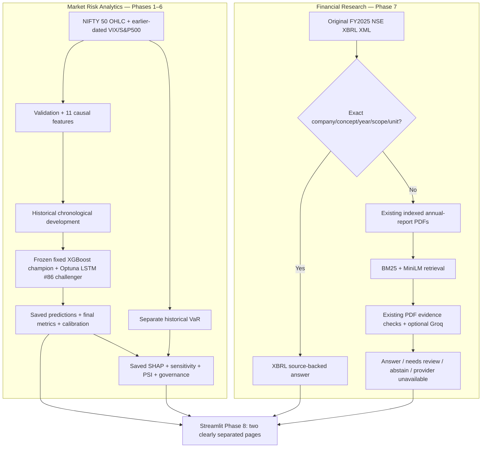

# RiskLens

**Financial risk analytics + source-grounded financial-document research**  
*Research workbench · Python · XGBoost · PyTorch LSTM · NSE XBRL · BM25/MiniLM · Groq · Streamlit*

RiskLens brings two **separate but complementary** finance-research workflows together in a local Streamlit application:

1. **Market Risk Analytics** reads saved historical results for a frozen NIFTY 50 next-session downside classifier. It presents model performance, probabilities, calibration, historical Value at Risk (VaR), explainability, feature drift, and governance. It does **not** train models, rescore the holdout, or produce live trading signals.
2. **Financial Research Assistant** answers questions using exact facts in the owner's original NSE XBRL filings first, then the existing indexed annual-report PDF retrieval and **optional, explicitly authorized** Groq fallback. It displays the actual answer, source references, financial units, and uncertainty status.

**Status (2 November 2026):** Phases 1–6 are complete and their historical model selection is frozen ([Phase 6 PR #6](https://github.com/devshah207/RiskLens/pull/6)). The Phase 7 XBRL/PDF research prototype was merged ([PR #7](https://github.com/devshah207/RiskLens/pull/7)). The premium local Streamlit application was merged as [Phase 8 PR #8](https://github.com/devshah207/RiskLens/pull/8); its final branch CI completed successfully. Phase 9 publishes truthful documentation, recruiter-facing narratives and a controlled demo guide. Phase 10 remains the comprehensive, beginner-first technical interview learning phase. The application runs locally; a public hosted Streamlit deployment is **not** claimed.

> **Research limitations:** RiskLens is **not** a production trading system, investment recommendation, credit-default model, bank-regulatory capital tool, or independently audited accounting advisor. Original fitted holdout model weights were not archived. The final holdout was opened once and will not be reused to change the models. Financial-document answers are not independently human-certified.

## Screens at a glance

| Streamlit page | What it shows | What it never does |
|---|---|---|
| **Market Risk Analytics** | Original saved Phase 5/6 evidence: 433 final-session forecasts, model comparison, calibration, VaR, TreeSHAP, LSTM sensitivity, drift | Retrain, modify threshold/features, rerun the one-time holdout, fetch live prices |
| **Financial Research Assistant** | Source-backed financial answers from XBRL or PDF/Groq, displayed prominently with citations and review status; offline recorded examples | Treat PDF similarity as certified numeric truth; call Groq on launch; store credentials in the repo |

**Portfolio screenshots:** screenshots of the approved premium interface have not been included in this release. The [safe capture guide](docs/PHASE9_PORTFOLIO_WALKTHROUGH.md) documents how to add them later, from a real working instance. Do not reuse older pre-premium screenshots or invent a successful RAG answer.

## Architecture



The two subsystems share **an analyst interface, not a training dataset**. FY2025 company annual reports were *not* historical features of the NIFTY classifier. The PDF/Groq route is used only when the exact XBRL route cannot answer; a similar-looking XBRL tag must not be substituted for another concept.

## Scientific results: one-time held-out evaluation

**Question:** After market close on session *t*, estimate the probability that the NIFTY 50 close on the **next completed trading session** will be at least 1% lower.

**Frozen evaluation:** 433 matched historical sessions from 2025 through September 2026, with **42** actual downside events. Model selection and hyperparameters were locked **before** the holdout was opened.

| Frozen model | ROC-AUC ↑ | Average precision ↑ | Brier ↓ | Log loss ↓ |
|---|---:|---:|---:|---:|
| **Fixed XGBoost, preselected champion** | 0.67275606 | 0.18610282 | 0.08477265 | 0.30329503 |
| **Optuna LSTM trial #86, challenger** | 0.68487395 | 0.21897271 | 0.08429920 | 0.30036197 |

The LSTM's slightly better holdout scores **do not** justify switching the preselected champion. At the original **0.50 cutoff, both models flagged zero positives**: TN=391, FP=0, FN=42, TP=0, hence **zero recall** for the 42 actual declines. AUC measures probability ranking; this is not a proven automatic decline-alert system.

**Independent historical VaR:** On the same 433 sessions, 95% VaR had **30 breaches (6.93%, versus 5% expected)** and 99% VaR had **7 breaches (1.62%, versus 1% expected)**. The 95% test raised independence/conditional-coverage concerns, including a March 2026 concentration. VaR is **not** an XGBoost/LSTM prediction. PSI signals historical feature/score shifts and does not prove why they occurred. SHAP and LSTM sequence permutation are descriptive, **not causal**.

Authoritative methodology: [`docs/PHASE6_MODEL_FREEZE_RECORD.md`](docs/PHASE6_MODEL_FREEZE_RECORD.md), [`docs/PHASE6_MODEL_FREEZE_MANIFEST.json`](docs/PHASE6_MODEL_FREEZE_MANIFEST.json), [`docs/PHASE5_HOLDOUT_FINDINGS.md`](docs/PHASE5_HOLDOUT_FINDINGS.md). Historical Phase 6 documents may still say "review branch"; the later PR #6 merge supersedes that release status, **not** their scientific numbers.

## Financial research: published Phase 7 outcomes

Original corpus: **five genuine FY2025 PDFs** for **four companies** (Reliance Industries, HDFC Bank, Infosys, ICICI Bank), plus **eight original NSE XBRL XML filings** (standalone and consolidated).

| Result on the repeatedly exposed 34-question development benchmark | Count |
|---|---:|
| Source-supported numerical/explanatory answers | **18** |
| Correct refusals of unsupported future-year questions | **6** |
| Incorrect refusals (answer was available in the original PDF) | **4** |
| Not run end-to-end | **6** |

These were assistant-reviewed against known source pages where applicable; they are **not** independent human certification or blind generalization results. Do **not** divide 18 by 34 and label it ordinary model accuracy. See [`docs/phase7/README.md`](docs/phase7/README.md) for released evidence and limitations.

## Run the premium Streamlit app locally (macOS / Python 3.11+)

Use the **existing RiskLens checkout**, not an unrelated generated project. Activate its virtual environment and install only the app and test dependencies:

```bash
cd ~/Downloads/RiskLens
source .venv/bin/activate
python -m pip install -e '.[ui,dev]'
PYTHONPATH=.:src python -m pytest -q tests/test_phase8_*.py
python -m streamlit run app/Home.py
```

Then open `http://localhost:8501`. The local UI only needs pandas, Streamlit and Plotly plus the project's normal base package to view saved market evidence. The released `ui` optional extra includes `streamlit>=1.41,<2` and `plotly>=6,<7`.

### Local evidence and real RAG inputs

All original raw files and many generated outputs are deliberately kept **outside public Git**. The UI reads these **without rewriting them**:

- Saved market study: `data/processed/phase5_final_holdout/final_holdout_predictions.csv`, `final_holdout_report.json`, `final_holdout_reliability.csv`; earlier and Phase 6 files under `data/processed/phase4_validation/` and `data/processed/phase6_*/`.
- The eight original NSE XBRL XML filings in `$HOME/Downloads/Archive.zip`.
- Original PDF SQLite index: `data/processed/research/real_acceptance/real_index.sqlite3`.
- Five annual-report PDFs in `data/raw/research_reports/`.
- Three saved fact banks under `data/processed/research/real_acceptance/phase7_completion/` (V3, V4 and V6 JSON).

To perform *real-source offline* PDF retrieval, the original MiniLM model must already be installed/cached and the research dependencies configured. The PDF route can retrieve pages without generating a final answer when Groq is disabled. **This is expected**, and candidate pages are not certified citations.

Only if using the real research backend and you need its optional components, install the required existing research extras:

```bash
python -m pip install -e '.[research-all]' lxml
```

**Groq is never required merely to view the dashboard.** Live Groq requests require an explicit checkbox and user action, use the owner's local `GROQ_API_KEY` and may make multiple API calls for one question. API keys must never be committed, uploaded or logged. Do not use other keys/accounts to work around quotas.

For detailed setup and a safe offline check, see [`docs/PHASE8_PREMIUM_UI_GUIDE_2026-11-02.md`](docs/PHASE8_PREMIUM_UI_GUIDE_2026-11-02.md), and the read-only preflight script `python scripts/phase8_rag_preflight.py --pdf-offline`.

## Quality and reproducibility

```bash
# Safe: existing app tests, no network/Groq or scientific reruns
PYTHONPATH=.:src python -m pytest -q tests/test_phase8_*.py
ruff check src tests scripts app --select F,E4,E7,E9
python scripts/verify_phase6_freeze.py
```

The freeze verifier is **read-only** but requires the complete original protected local files. If they are missing, it cannot report 9/9 PASS; do not regenerate holdout results to satisfy it. Some Phase 7 tests are skipped without original PDFs/JSON/XML. Skipped tests are not passes. Consult [`docs/PHASE9_RELEASE_CHECKLIST.md`](docs/PHASE9_RELEASE_CHECKLIST.md) for the release audit and CI gates.

The [GitHub CI workflow](.github/workflows/quality.yml) installs the **UI extra** with the original development, deep-learning and tuning extras, then runs lint and the repository test suite. It **must not** silently skip real failures.

## Repository map and presentation

| Path | Responsibility |
|---|---|
| `app/Home.py`, `app/pages/` | Premium Streamlit home, market risk, financial research pages |
| `app/components/` | Shared UI, source citations and Plotly charts |
| `app/services/` | Read-only saved-data adapters and calls into the original Phase 7 engine |
| `src/risklens/features/`, `src/risklens/models/`, `src/risklens/evaluation/` | Original historical market research (frozen) |
| `src/risklens/research/` | Original Phase 7 XBRL, PDF, retrieval and Groq research engine |
| `docs/` | Protocols, evidence governance, methods, release notes and portfolio guidance |
| `scripts/phase8_rag_preflight.py` | Safe offline original-source integration check |
| `scripts/verify_phase6_freeze.py` | Read-only original evidence fingerprint verifier |

For a short recruiter walkthrough, source selection notes and safe screenshot instructions, see [`docs/PHASE9_PORTFOLIO_WALKTHROUGH.md`](docs/PHASE9_PORTFOLIO_WALKTHROUGH.md). For concise Citi and StockGro resume claims, see [`docs/PHASE9_RESUME_AND_INTERVIEW_NARRATIVES.md`](docs/PHASE9_RESUME_AND_INTERVIEW_NARRATIVES.md).

**Contributors:** RiskLens educational research project. Source filings and market datasets remain subject to their original providers' licensing, attribution and redistribution terms; do not commit or distribute them merely because the local app can open them.
