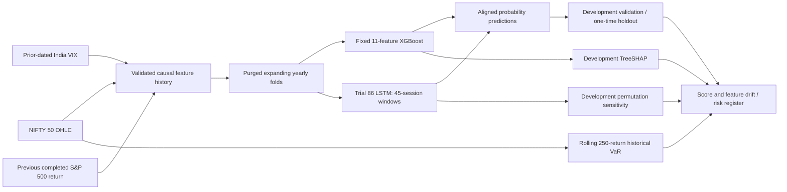

# RiskLens — Explainable Financial Risk Modeling, Validation & AI Research Platform

**Research prototype | Python · XGBoost · PyTorch LSTM · Optuna · pandas · scikit-learn · model monitoring · historical VaR**

**Project status (30 October 2026):** Phases 1–5 are complete for the agreed research scope. Phase 6's scientific investigations, evidence freeze, retrospective monitoring audit and governance documents are implemented and reviewed; formal Phase 6 sign-off requires approval and merge of [draft PR #6](https://github.com/devshah207/RiskLens/pull/6). Phases 7–10 remain part of the original plan: evaluated financial-report RAG, an integrated Streamlit app, portfolio packaging, and detailed Citi/StockGro interview defense. See [the canonical 10-phase roadmap](docs/ROADMAP.md).

> **Research boundary:** RiskLens is not a trading product, credit default model, regulatory capital engine, production alerting system or investment recommendation. The 2025–September 2026 independent holdout has **already been opened once**. Do not retrain, rescore it for new model selection, optimize thresholds, or promote a candidate based on those outcomes.

## Research question and timing contract

At the **close of NIFTY 50 trading session `t`**, estimate the probability that the price index's **next observed session** closes at least 1% lower:

```text
event_t = 1 if close[t+1] / close[t] - 1 <= -0.01 else 0
P(event_t = 1 | information available at NIFTY close t)
```

The future close appears **only in historical outcomes**. Training/validation splits are expanding chronological folds with cross-boundary label purges. Inputs include nine current/past NIFTY-derived features plus strictly *earlier-dated* India VIX and previous completed S&P 500 return. External observations must be no more than seven calendar days old. Original market CSVs and research outputs remain local and are ignored by Git; this repository commits code, synthetic tests, documentation and evidence fingerprints instead.

## Architecture and what actually exists



**Frozen 11-feature order:** `return_1d`, `return_5d`, `volatility_20d`, `intraday_range`, `intraday_return`, `opening_gap`, `rsi_14`, `ema_50_distance`, `volatility_10d`, `india_vix_level`, `sp500_previous_return_1d`.

- **Preselected research champion:** fixed XGBoost, 80 trees, depth 2, learning rate 0.04, and the other parameters frozen in [`docs/PHASE6_MODEL_FREEZE_MANIFEST.json`](docs/PHASE6_MODEL_FREEZE_MANIFEST.json).
- **Challenger:** actual completed Optuna LSTM study **trial #86**, 11 features, 45 consecutive sessions, two recurrent layers, hidden size 24, dropout 0.3413771488170494, 24 epochs, batch 128. Original one-time holdout fitting seed was 4051. The stored Optuna SQLite study provenance was verified; no fresh tuning is authorized.
- **Separate historical model:** `models/sequence_lstm.py` implements an older 30-session LSTM with LayerNorm/MLP and different training policy. Its historical evaluation is retained but **must not** be confused with frozen trial #86.
- **VaR:** a separate rolling 250-return historical simulation at 95% and 99%; it is not a prediction from either classifier.
- **Interpretation:** native XGBoost TreeSHAP on pre-2025 development training observations (log-odds contributions); LSTM temporal-feature permutations on 2024 development predictions. Neither is causal attribution nor explanation of archived final-holdout weight objects. The original final fitted weights were not serialized.

## Measured frozen-model results

**Original one-time out-of-time holdout:** 433 aligned forecast dates from 2025 through **29 September 2026**, 42 downside events. These results are already observed and must not become a new selection objective.

| Frozen candidate | ROC-AUC ↑ | Average precision ↑ | Brier ↓ | Log loss ↓ |
|---|---:|---:|---:|---:|
| **Fixed XGBoost — preselected champion** | 0.672756 | 0.186103 | 0.084773 | 0.303295 |
| **Actual Optuna trial #86 LSTM — challenger** | 0.684874 | 0.218973 | 0.084299 | 0.300362 |

The LSTM scored numerically better on the pooled holdout, **but that does not authorize a post-hoc champion switch or establish statistically reliable superiority**. At the illustrative 0.50 classification cutoff both models predicted **zero** positive events, detecting **0/42** actual downside events. They are research probability estimators, not validated automatic alerts.

| Holdout period | Forecasts | Downside events | XGBoost ROC-AUC | LSTM ROC-AUC |
|---|---:|---:|---:|---:|
| 2025 | 249 | 15 (6.02%) | 0.693447 | 0.715385 |
| Jan–Sep 2026 | 184 | 27 (14.67%) | 0.619486 | 0.636943 |

**Historical VaR on the same 433 dates:** 95% VaR had 30 exceptions (6.93%); the *unconditional* exact binomial p-value was 0.0763, but the *independence* and *conditional-coverage* approximate p-values were 0.0140 and 0.0107, respectively. The 99% VaR had 7 exceptions (1.62%; exact binomial p=0.216). March 2026 concentrated nine 95% and four 99% exceptions. These are model-risk findings, not claims of regulatory failure or known external causes.

**Monitoring:** Input drift affected EMA-50 distance, RSI-14 and India VIX; independent indicator reconstructions and VIX source overlap did not establish a calculation bug. Original fixed-bin score PSI was **0.06829 (XGBoost)** and **0.47019 (LSTM)**. A saved-prediction audit verified both and found within-final-model 2025-versus-2026 PSI of approximately **0.42518** and **0.42334**, respectively. Comparing pooled annual development refits against the single final fitted instance is confounded; the whole PSI shift cannot be uniquely assigned to the market regime. These are descriptive research diagnostics, not bank-approved alarms.

For full results, methods and limitations see:

- [`docs/PHASE5_HOLDOUT_FINDINGS.md`](docs/PHASE5_HOLDOUT_FINDINGS.md) and [`docs/PHASE6_MODEL_FREEZE_RECORD.md`](docs/PHASE6_MODEL_FREEZE_RECORD.md)
- [`docs/RiskLens_Phase6_Review_Draft.md`](docs/RiskLens_Phase6_Review_Draft.md) — scientific memo, **pending owner approval / merge**
- [`docs/RiskLens_Phase6_Saved_Prediction_PSI_Audit_2026-10-30.md`](docs/RiskLens_Phase6_Saved_Prediction_PSI_Audit_2026-10-30.md) — saved-prediction monitoring analysis

## Historical development work (preserved, not the frozen challenger)

The earlier **manually designed 30-session** LSTM benchmark evaluated 1,238 predictions during 2020–2024 and recorded approximately Brier **0.10320**, ROC-AUC **0.583** for its 11-feature sequence model versus fixed XGBoost Brier **0.10280**, ROC-AUC **0.612**. These older numbers belong to that *different experiment*. The genuine trial #86 LSTM achieved development-only pooled Brier **0.10260**, ROC-AUC **0.61936** across 2020–2024; XGBoost's aligned frozen comparison was Brier **0.10282**, ROC-AUC **0.60949**. Optuna's 2020–2022 selection years and repeatedly examined 2023–2024 years are **not** independent test evidence.

## Installation and safe checks

Requirements: Python **3.11+**; Apple Silicon MPS for PyTorch is supported, but not required for these read-only checks.

```bash
python -m pip install -e '.[dev,deep,tuning]'
python -m pytest -q
ruff check src tests scripts --select F,E4,E7,E9
python scripts/verify_phase6_freeze.py
```

`verify_phase6_freeze.py` verifies the original protected local evidence hashes and model-selection contract **without fitting or scoring models**. A successful run requires original ignored files to exist at their recorded paths; it does not mean original fitted model weights were archived. The repo's GitHub CI uses synthetic test data, not your ignored market CSVs.

**Do not run** `risklens evaluate-holdout`, `risklens tune` or `risklens evaluate-frozen` as a routine verification step. The holdout is already opened, the Optuna study is frozen, and these commands are for historical research workflows rather than Phase 6 sign-off.

The earlier standalone **offline HTML Citi demo** is accessible through `bash scripts/run_citi_demo.sh` but remains the *legacy development demo*, not the completed Phase 8 Streamlit app.

## Code and artifacts map

| Path | Purpose |
|---|---|
| `src/risklens/data/`, `src/risklens/features/` | Market ingestion, point-in-time alignment, causal feature/label engineering |
| `src/risklens/models/frozen_comparison.py`, `optuna_research.py` | Historical frozen trial #86 verification and development comparison |
| `src/risklens/evaluation/final_holdout.py` | Historical one-time final evaluation; **do not rerun** |
| `src/risklens/evaluation/risk_validation.py` | Calibration, paired Brier uncertainty and separate VaR tests |
| `src/risklens/evaluation/monitoring.py`, `feature_drift.py`, `drift_investigation.py` | Model-output monitoring, feature PSI and source/formula investigation |
| `src/risklens/models/explainability.py`, `lstm_explainability.py` | TreeSHAP and noncausal LSTM sensitivity |
| `scripts/verify_phase6_freeze.py`, `tests/test_phase6_freeze.py` | Original-evidence verification and synthetic regression coverage |
| `data/processed/phase4_validation/`, `phase5_final_holdout/`, `phase6_*/` | Real research artifacts on user Mac, **ignored by Git** |
| `docs/` | Roadmap, immutable protocols, audit findings, freeze/governance records |

**Next engineering work after Phase 6 governance merge:** Phase 7 — evaluated, citation-grounded financial filings retrieval and AI research assistant; then Phase 8 Streamlit integration, Phase 9 portfolio and compliance packaging, and Phase 10 comprehensive technical interview defense.

## Scientific and governance limits

- Strict earlier-dated joins and local structural validation do not independently certify source vendor publication timestamps or redistribution rights.
- Risk metrics are sample- and regime-sensitive; the 2026 period ends in September, not December.
- Explainability is retrospective, noncausal and model-instance specific; no original fitted weights archive exists.
- Results do not validate investment utility, alert thresholds, Citi deployment, live trading or regulatory capital adequacy.
- **No GitHub push without explicit owner permission for that push; no PR merge without separate explicit permission.**
