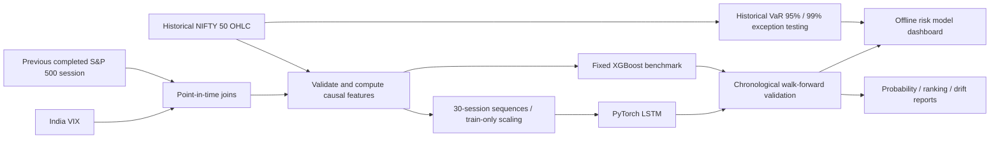

# RiskLens — Financial Market Risk Modeling, Deep Learning & Independent Model Validation

**Python · PyTorch (LSTM) · XGBoost · scikit-learn · Pandas · Market Risk · Backtesting · Model Monitoring**

> **Research result:** Built a leakage-audited, multi-factor market-risk research system using NIFTY 50, India VIX and the S&P 500. Compared sequence-based **two-layer LSTM** against **XGBoost** and a historical probability baseline over **1,238 strictly out-of-training yearly validation observations (2020–2024)**. Implemented 95%/99% historical Value-at-Risk (VaR) exception monitoring and an offline validation dashboard. Findings are reported even when the neural network underperforms.

**This is research software, not a deployed trading product, credit-risk score, regulatory capital model or investment recommendation.**

## Why this project exists

Financial institutions require more than model accuracy: they need **data provenance, point-in-time data alignment, robust model benchmarking, exception monitoring, independent validation and transparent limitations**. RiskLens implements these controls for a concrete market-risk research question:

> At the close of NIFTY trading session *t*, what is the probability that the NIFTY 50 price index closes at least 1% lower on the following observed trading session?

`event_t = 1[(close_{t+1} / close_t - 1) <= -0.01]`

The next-session close is used **only to construct historical outcomes**, not as a predictor.

## Architecture



**Inputs:** 11 historical features: NIFTY 1-day and 5-day returns, 20-day and 10-day volatility, intraday high–low range, intraday return, opening gap, RSI-14, distance to EMA-50, prior India VIX level, and prior completed S&P 500 daily return. The deep-learning models process **30 successive sessions**, giving the network a temporal context instead of one observation per row.

**Neural architecture:** two-layer PyTorch `nn.LSTM` (hidden size 24, dropout 0.15) → LayerNorm → nonlinear MLP → binary downside logit. AdamW with gradient clipping; inner chronological early stopping with boundary-label purging and **refit on all earlier-year training data**; no validation-year labels used in optimization or epoch selection. Scalers are refitted on training data only.

**Temporal evaluation:** train on preceding years, validate on 2020, 2021, 2022, 2023, and 2024 separately. All comparisons use the *same validation dates and target outcomes*. **2025–2026 final holdout is sealed** and has not been evaluated.

## Measured development findings

| Approach | Brier ↓ | Log loss ↓ | Pooled ROC-AUC ↑ | Average precision ↑ |
|---|---:|---:|---:|---:|
| Historical event-rate baseline | 0.10462 | 0.36840 | * | 0.098 |
| XGBoost (9 features) | 0.10291 | 0.35940 | 0.597 | 0.160 |
| **XGBoost (11 features)** | **0.10280** | **0.35815** | **0.612** | **0.172** |
| LSTM (9 features) | 0.10903 | 0.38812 | 0.476 | 0.128 |
| LSTM (11 features) | 0.10320 | 0.36502 | 0.583 | 0.171 |

\* The baseline is constant *within each fold*, but its predicted event rate changes across folds. A pooled ROC-AUC across those different fold constants is not meaningful as a ranking benchmark.

**Interpretation:** The LSTM does not outperform XGBoost on the historical development years. External information improves the LSTM substantially versus its 9-feature version. This is evidence of the project having a sound comparative evaluation process, **not** evidence of stable market predictability or of results on an untouched final holdout. Several yearly ROC-AUC values are near or below random, and development-year model comparisons have been inspected repeatedly.

### Historical VaR exception monitoring (250-session rolling quantile)

| Estimate | Expected breach rate | Observed breach rate | Exceptions / days | Exact binomial coverage p-value |
|---|---:|---:|---:|---:|
| 95% VaR | 5.00% | 5.41% | 67 / 1,238 | 0.514 |
| 99% VaR | 1.00% | 1.78% | 22 / 1,238 | 0.0098 |

99% historical VaR under-covered observed downside losses on these development dates, particularly during stressed years. The binomial test assumes independent exceptions, which can be violated by volatility clustering; numbers are illustrative **research diagnostics**, not regulatory VaR qualification.

## Run the project

Python 3.11+ recommended. **Raw real market CSVs are kept locally and excluded from Git**; run the earlier import steps (documented in `docs/`) to construct the inputs.

```bash
python -m pip install -e '.[dev,deep]'
python -m pytest -q

# Once previous NIFTY, VIX, S&P 500 ingestion steps are completed:
bash scripts/run_citi_demo.sh
```

This prints both model and VaR evaluation results and writes:

```
data/processed/citi_validation/
├── risk_model_validation_dashboard.html   # standalone, offline HTML
├── sequence_lstm_predictions.csv           # 1,238 development predictions
├── sequence_lstm_validation_report.json    # complete fold audits & metrics
├── historical_var_backtest.csv             # realized returns, VaR, exceptions
└── historical_var_report.json              # exception rates & coverage tests
```

To run the deep learning comparison directly:

```bash
python -m risklens.models.sequence_lstm_cli \
  data/processed/multiyear/nifty50_ohlc.csv \
  data/processed/external/nifty50_external_development.csv \
  data/processed/multifactor_comparison/multifactor_comparison_predictions.csv \
  --output-dir data/processed/citi_validation --overwrite
```

### Code map

- `src/risklens/data/` — OHLC validation, ingestion, source provenance and point-in-time external joins.
- `src/risklens/features/dataset.py` — causal returns, volatility, RSI and EMA calculations; target-label boundary purging.
- `src/risklens/models/multifactor_comparison.py` — controlled 9-vs-11-feature tabular XGBoost benchmark.
- **`src/risklens/models/sequence_lstm.py`** — multi-session tensor construction, train-only transformations, nested chronological early stopping, expanding-fold LSTM research, audit/report/dashboard.
- **`src/risklens/models/market_risk_monitor.py`** — historical-simulation 95%/99% VaR, violations and simple coverage test.
- `tests/` — data contracts, train/test boundaries, malformed data, temporal causality, source alignment, numerical stability and reproducibility.
- [`docs/CITI_MODEL_VALIDATION_MEMO.md`](docs/CITI_MODEL_VALIDATION_MEMO.md) — findings, root-cause analysis and limitations.
- [`docs/CITI_RESUME_AND_INTERVIEW.md`](docs/CITI_RESUME_AND_INTERVIEW.md) — factual resume bullets and technical interview explanations.

## Risk controls and limitations

- **Availability / look-ahead:** foreign-market inputs use *strictly earlier* available source dates, including the previous US close rather than the unobserved same-day US close.
- **Train-test boundary:** final session of a training year does not use the next year's target label; early stopping uses only past data with another purged boundary.
- **Data quality:** checks duplicate dates, nonfinite OHLC, invalid India VIX records, source-data ages, missing external features and source fingerprints. Structural checks do not independently authenticate downloaded market data.
- **Reproducibility:** deterministic training on CPU with fixed architecture/initialization seeds; audit includes selected epochs and SHA-256 file hashes.
- **Validation caveat:** five years of *development* results have guided previous exploration; they must not be described as a one-time unbiased holdout. The 2025–2026 period has **not** been used as model training, feature or outcome input.
- **Domain caveat:** this is index market-risk research, not consumer credit underwriting; the target is an arbitrary fixed next-session move, not an economically optimized trading policy.

For provenance and earlier design decisions, see `docs/project_charter.md`, `docs/data_contract.md`, `docs/decisions.md`, and earlier `phase*learning_guide.md` documents.
